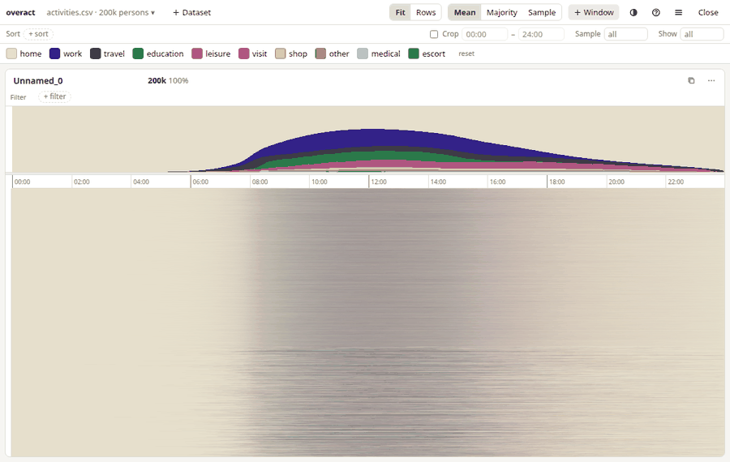
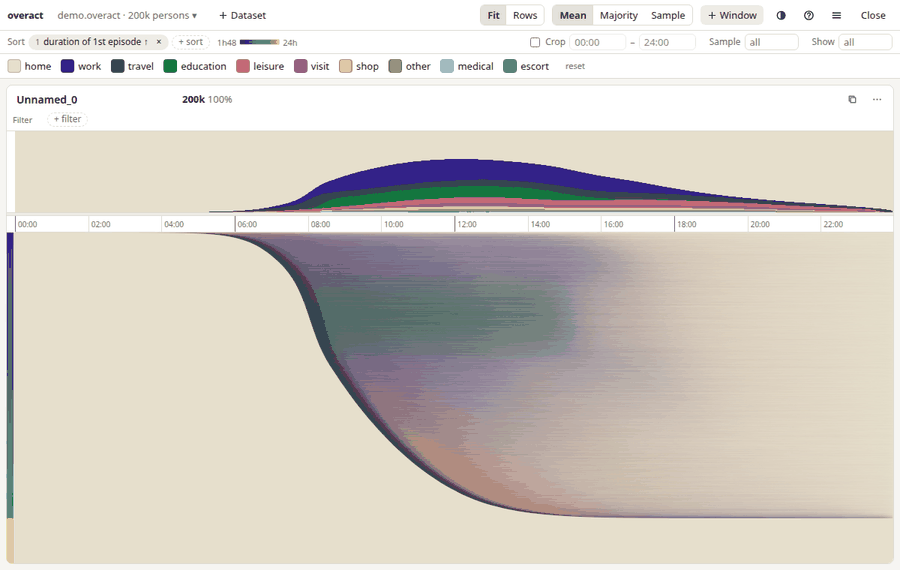
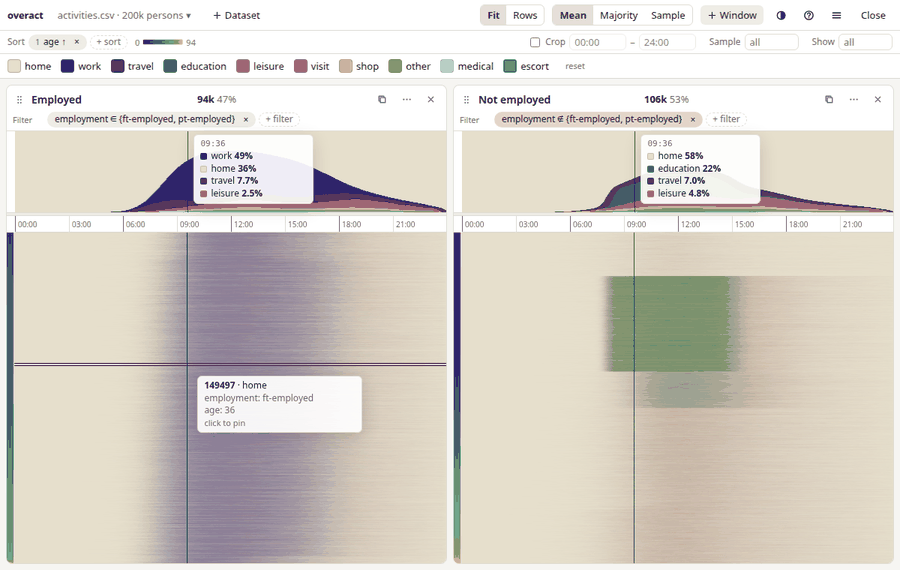
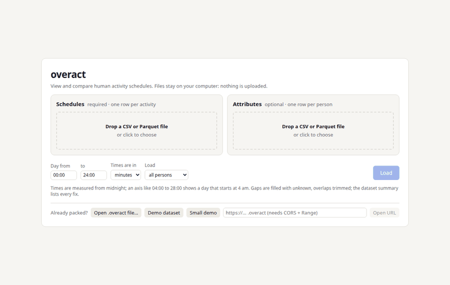

# overact

**overact** is a browser viewer for comparing human activity schedules at scale. Each
person's day is a row of coloured blocks along the time of day. Stack millions of
rows to see a whole population, then filter, sort and compare up to six groups
side by side.

It runs entirely in your browser. Files are read locally and **nothing is
uploaded**.



- **Overact handles 10 million schedules.** Loading, filtering, sorting  and scrolling are all optimised. The engine is Rust compiled to WebAssembly, and uses
  multiple threads when the browser allows it.
- **Compare groups.** Up to six windows, each with its own filter, sharing one
  sort order (for example age, then income).
  - **Fit** mode stretches each population to the window height, so the same
    height means the same percentile in every window.
  - **Rows** mode gives every window the same number of persons per pixel row.
- **Compare datasets.** **+ Dataset** loads another dataset with the same time
  axis, such as another survey year or a model run. A window on it opens beside
  the first with the same filter, and a dropdown in each window's header picks the
  dataset it shows. The sort, legend and filters match columns and activities by name.



- **Filter and sort by anything.** Use any attribute (numeric ranges, category
  sets, booleans), or the schedules themselves. A schedule measure is built in
  three steps: count, start, duration or end; of all episodes or the 1st, 2nd,
  …, last; of any activity, one activity, or anything except one ("end of 1st
  episode", "duration of 2nd episode", "time in non-home"). Filters can also
  ask "doing work at 09:00" or "at home all of 20:00–22:00".
- **Exact numbers.** A strip above each window shows the exact share of each
  activity by minute. Hover anywhere for the activity mix at that time in every
  window.
- **Shared controls.** The bar above the windows sets the sort keys (drag to
  reorder), an optional time crop, a random **Sample** of each window's
  filtered persons, and how many rows each window **Shows**.
- **Zoom in time.** Drag on a window's time axis to select a range, then zoom
  to it or filter that window on "doing an activity during it". The mouse
  wheel on an axis zooms all windows (Shift pans); double-click shows the
  whole day again.
- **See individuals.** Set Show to a small number (or load a small dataset) and
  each schedule is drawn as a tall band; scroll to move through the rest. Hover
  to see a person's attributes; click to pin their full schedule.



- **Share and export.**
  - Save the view to a file, or copy a link that holds the view (never the data).
  - Export a PNG (whole view or one window), an SVG of the legend and profiles,
    or a window's person ids as CSV or Parquet for use back in Python.
- **Accessible defaults.** The default palette is colour-blind-safe and checked
  under simulated colour-vision deficiency ([docs/PALETTE.md](docs/PALETTE.md)).
  There are light and dark themes, and keyboard shortcuts (press `?`).

## Try it

The site is a static page. Once GitHub Pages is enabled for this repository,
it is served at `https://<owner>.github.io/overact/`. Click **Demo dataset** to
load 200,000 synthetic persons, or **Small demo** for 200 persons split into
four windows by employment (employed, student, retired, unemployed). You can also run it locally (see
[Development](#development)).

## Use your own data

Drop your tables onto the viewer. The load page has two cells:

**Schedules** (required): one row per activity episode, as CSV, TSV or Parquet.

| pid | seq | act | start | end |
|---|---|---|---|---|
| p1 | 1 | home | 0 | 465 |
| p1 | 2 | work | 465 | 1080 |
| p1 | 3 | home | 1080 | 1440 |

**Attributes** (optional): one row per person, with any number of columns.

| pid | age | sex | employment | income |
|---|---|---|---|---|
| p1 | 42 | female | ft-employed | 51000 |

The viewer guesses which column is the person id, activity, start and end (or
duration), shows the first rows, and lets you change any choice. Choose the
time axis (default 00:00 to 24:00; at most 34 hours, such as 04:00 to 28:00),
the time unit, and which attribute columns to keep, then click **Load**. The
tables are read, cleaned and packed inside the browser; nothing is uploaded.
Rows sorted by person load fastest; other orders work but take about four
times as long and twice the memory.



To skip parsing next time, use **menu (≡) → Dataset as .overact file** and open that
file instead: it loads in a few seconds and reads attribute columns only when
they are used.

### Packing from the command line

`overact-pack` does the same conversion for scripts and batch jobs. It is the
viewer's own loader (Rust, `crates/overact-ingest`) built as a command, so it
writes the same `.overact` file the viewer saves:

```sh
cargo install --path crates/overact-ingest   # provides overact-pack

overact-pack activities.parquet -a attributes.parquet -o mydata.overact --seq-col seq
```

In a checkout, `uv run --project py overact-pack ...` also works: it builds
the binary on first use. `uv tool install ./py` provides `overact-synth` and
`overact-validate`, and an `overact-pack` that runs the installed binary.

Useful options (`overact-pack --help` lists them all):

- `--id-col`, `--act-col`, `--start-col`, `--end-col` name your columns
  (defaults `pid`, `act`, `start`, `end`). Use `--duration-col` instead of an
  end column, and `--attr-id-col` if the attributes table names its id column
  differently.
- `--time-unit minute|second|hour` sets the unit of the times (default minutes).
- `--axis 240,1680` sets the time axis in minutes, for example 04:00 to 04:00
  the next day. The default is `0,1440`; at most 2048 minutes are allowed.
- `--columns` / `--exclude` choose which attributes to keep. Identifier-like
  text columns are skipped unless you name them.
- `--report fixes.csv` lists every change the converter made (the viewer's
  dataset summary shows counts and examples).

**What loading fixes.** Each person's activities must tile the axis with
no gaps or overlaps. The viewer and `overact-pack` (the same code) repair them
and report every fix:
- It sorts unsorted rows.
- It drops empty rows and clips rows to the axis.
- It trims overlaps (the earlier start wins).
- It fills gaps with an `unknown` activity.

Back-to-back rows of the same activity are kept as separate episodes, not merged.

**Size and memory.** Text attributes become categories, numbers keep their
precision (`overact-pack --f64` for doubles), and missing values stay missing.
Loading 10 million persons (69 million activity rows) takes about 50 s from
Parquet or 65 s from CSV in the browser on a 2017 laptop, using about 1.2 GB.
`overact-pack` takes about 30 s and 0.9 GB of RAM.

Check a file with `overact-validate mydata.overact`. The format is documented in
[docs/FORMAT.md](docs/FORMAT.md).

**Low-memory machines:** choose "Load a random 10%" (or 1%, 25%, 50%) on the
start page.

### Back to Python

A window's persons (in display order) export as CSV or Parquet: use the window
menu `⋯` → *Export person ids*. You can also read `.overact` files directly:

```python
from overact import OveractFile

f = OveractFile.open("mydata.overact")
person, start, end, code = f.schedules()  # flat numpy arrays
ages = f.column("age")  # decoded values, None for missing
```

### Similarity orderings

The viewer does not cluster or seriate schedules itself. To order persons by
similarity, compute the order in Python (for example from a clustering or a
1-D embedding of the schedules) and add it as a numeric attribute column, such
as `order`. Then sort by it like any other column. Put a cluster label in a
second column to filter by cluster.

### Synthetic data

`overact-synth -n 1e6 -o out/` writes a correlated synthetic population (age,
employment, education, income, …) whose schedules follow from the attributes.
Employed people work, children go to school, older workers start earlier.
It can produce 10 million persons and more.

## Performance

Measured at 10 million persons on a 2017 laptop CPU in Chromium:

| Operation | Single-threaded | With threads |
|---|---|---|
| Load | 1.6 s | 1.7 s |
| Filter | 60 ms | 98 ms |
| 2-key sort of 4.7M rows | 233 ms | 146 ms |
| Re-raster | 35 ms | 24 ms |
| Memory | about 620 MB | about 650 MB |

[docs/PERFORMANCE.md](docs/PERFORMANCE.md) has the full budget table, a
comparison with plain TypeScript, and the effect of threads and SIMD.

## How it works

```
py/                   overact-synth, overact-validate, overact-pack wrapper (uv project)
crates/overact-core/  pure Rust engine: format reader, filters, radix sort,
                      rasteriser, profiles, derived schedule features, jobs
crates/overact-ingest/ CSV / Parquet tables straight to a dataset: the
                      packing rules, in the browser and as `overact-pack`
crates/overact-wasm/  thin wasm-bindgen API over the core
web/                  Svelte 5 + TypeScript viewer; the engine runs in a worker
docs/                 FORMAT.md, PERFORMANCE.md, PALETTE.md
```

- **Storage.** Each segment is packed into 16 bits (an 11-bit start minute and
  a 5-bit activity code). Ten million days at about 7 segments each take
  roughly 140 MB.
- **Loading.** The data worker copies `.overact` file slices straight into
  WebAssembly memory, and reads attribute columns only when first used.
  CSV and Parquet tables are streamed through `overact-ingest` inside the
  worker (read synchronously with `FileReaderSync`); each person is cleaned and
  packed as soon as their rows end.
- **Jobs.** Filters, sorts and profiles run in small steps, so a newer request
  cancels an older one and drawing never waits.
- **Drawing.** Rasterisation draws pixel buffers, never DOM elements. When many
  persons share one pixel row it samples up to 32 of them, then refines with an
  exact pass once the view is still.
- **Threads.** With threads (rayon, via `wasm-bindgen-rayon`) the same code
  runs in parallel and gives identical results.

`overact-core` has no WebAssembly or browser dependencies, so it can also back
a native server.

## Development

Prerequisites:
- Rust (stable) with the `wasm32-unknown-unknown` target.
- [`wasm-bindgen-cli`](https://crates.io/crates/wasm-bindgen-cli) 0.2.129 (it
  must match the `wasm-bindgen` crate version).
- Node 22.
- [uv](https://docs.astral.sh/uv/).
- For the threaded build only: a nightly toolchain with `rust-src`.

```sh
scripts/build-wasm.sh              # single-threaded engine -> web/src/wasm/pkg
scripts/build-wasm.sh --threads    # also the threaded + SIMD engine (nightly)

cd web && npm install && npx vite  # http://localhost:5173

cargo test --workspace                                     # Rust unit, property and fixture tests
cargo test -p overact-core --features parallel --release   # parallel == sequential
cd py && uv run pytest                                     # packer round trips, synth, validate
cd web && npm run check && npm test                        # types, unit + worker-protocol tests
cd web && npx playwright test                              # browser smoke tests
cd web && npm run bench -- path/to/file.overact            # browser benchmark
cargo bench -p overact-core --bench engine -- file.overact # native benchmark
```

The threaded engine needs a cross-origin isolated page. `vite` and
`vite preview` send the COOP/COEP headers. On GitHub Pages,
`web/public/coi-serviceworker.min.js` adds them. Without isolation the app
falls back to the single-threaded engine. To force single-threaded mode, set
`localStorage['overact.threads'] = 'off'`.

The CI workflow runs formatting, clippy, all tests, the type-check, the site
build and the Playwright smoke tests. The Pages workflow publishes `web/dist`.

## License

MIT. See [LICENSE](LICENSE). `coi-serviceworker` is MIT-licensed by Guido
Zuidhof and contributors.
